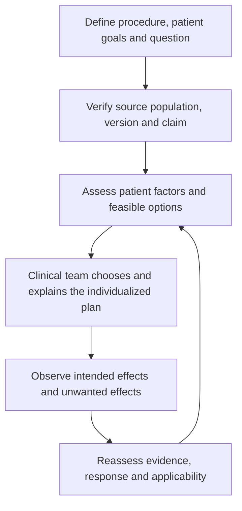

# TKA evidence map: applied cases

28 October 2026. Applications across modality, regional strategy, adjuncts, opioid history, outcomes and recovery.

All examples are entirely synthetic, independent of real encounters, charts or shadowing observations. They illustrate source-informed reasoning, not observed administrations, validated treatment plans, standardized drug regimens or clinical competence. Male/female labels are descriptive; any difference in the discussion follows history, procedure and evidence applicability rather than sex alone. Female cases are nonpregnant unless explicitly stated otherwise.

## Shared example set and method

Read [the local anesthesia-options case set](ANESTHESIA_OPTIONS_AND_CASES.md) for the same four-modality comparison, 12 general teaching cases, medication roles/routes, monitoring distinctions and decision flows used throughout this portfolio. The topic-specific pairs below apply that format to this repository.

Standardize the reasoning: identify the clinical question → verify source/version and population → distinguish published recommendation from fictional inference → assess patient-specific alternatives and monitoring → reassess effects and harms. A DOI establishes an identifier, not the truth or clinical suitability of every inferred decision. Source verification here covers identities and available abstracts/selected passages; it is not an exhaustive full-text systematic appraisal.

## TK-01 — Spinal versus general anesthesia

- **Synthetic male example:** 68-year-old male, 177 cm, 82 kg, primary unilateral TKA and no listed anticoagulant.
- **Synthetic female example:** 68-year-old female, 162 cm, 65 kg, primary TKA taking apixaban with an uncertain last dose.

**Worked application:** Discuss modality after verifying anticoagulant, renal, airway and preference details; an incomplete anticoagulant history does not support declaring spinal appropriate.

**Options / medication and administration context:** Spinal or general anesthesia may be assessed; procedure-specific postoperative analgesia is a separate plan. Do not advise stopping anticoagulants from this example.

**Decision flow:** Verify prescription/timing → check neuraxial suitability → discuss modality and backup → monitor.

**Source map:** [A](#source-registry), [K](#source-registry), [M](#source-registry). The sources support the named concepts, not the existence or validation of these fictional administrations.

## TK-02 — Regional analgesia and background regimen

- **Synthetic male example:** 65-year-old male, 180 cm, 85 kg, primary TKA with periarticular local infiltration already planned.
- **Synthetic female example:** 65-year-old female, 164 cm, 66 kg, similar surgery with infiltration unavailable in the fictional discussion.

**Worked application:** Identify the background regimen before comparing an added block; do not assume iPACK adds the same benefit in both contexts. The source recommendation for ACB plus periarticular infiltration is primary-TKA-specific.

**Options / medication and administration context:** Discuss a single-shot adductor canal block and infiltration where suitable; iPACK is not automatically added simply because it is in a repository title.

**Decision flow:** Document baseline analgesia → compare incremental evidence → assess exposure/function → select and reassess.

**Source map:** [K](#source-registry), [X](#source-registry). The sources support the named concepts, not the existence or validation of these fictional administrations.

## TK-03 — Nonopioid adjuncts are not a mandatory cocktail

- **Synthetic male example:** 72-year-old male, 175 cm, 78 kg, primary TKA with CKD.
- **Synthetic female example:** 72-year-old female, 160 cm, 60 kg, primary TKA with conduction disease and sleep apnea.

**Worked application:** Risk factors make fixed adjunct stacking inappropriate. The primary-TKA guideline does not supply a universal dexmedetomidine/ketamine/lidocaine pathway.

**Options / medication and administration context:** Suitable baseline analgesics, local/regional options and rescue opioids can be discussed; NSAID, alpha-2 agonist and sedative suitability require separate appraisal.

**Decision flow:** Assess risk/indication → keep only justified components → define rescue and monitoring → reassess.

**Source map:** [K](#source-registry), [P](#source-registry), [LIDO](#source-registry), [DEX](#source-registry). The sources support the named concepts, not the existence or validation of these fictional administrations.

## TK-04 — Chronic opioid exposure and rescue

- **Synthetic male example:** 59-year-old male, 181 cm, 86 kg, taking prescribed long-term opioids before TKA.
- **Synthetic female example:** 59-year-old female, 165 cm, 67 kg, opioid-naive but fears dependence.

**Worked application:** The medication history and patient concerns require different conversations; neither vignette justifies abrupt cessation or withholding analgesia to preserve an opioid-free label.

**Options / medication and administration context:** An individualized perioperative pain plan may use complementary nonopioid/regional options and assessed opioid rescue; long-term therapy requires the treating prescriber/team.

**Decision flow:** Reconcile medicines and goals → assess withdrawal/tolerance context → plan acute and follow-up care.

**Source map:** [K](#source-registry), [P](#source-registry). The sources support the named concepts, not the existence or validation of these fictional administrations.

## TK-05 — Patient-reported outcomes and interpretation

- **Synthetic male example:** 66-year-old male, 178 cm, 80 kg, less pain at rest but difficulty walking.
- **Synthetic female example:** 66-year-old female, 163 cm, 64 kg, higher pain at rest with better walking and fewer unwanted effects.

**Worked application:** Different outcome domains can move in different directions. Compare the same time points and instruments; do not infer a superior regimen or statistical equivalence from two fictional patients.

**Options / medication and administration context:** Analgesic benefit is assessed alongside function, nausea/drowsiness and preferences, not opioid consumption alone.

**Decision flow:** Define outcome/time point → compare domains and harms → revisit goals → reassess.

**Source map:** [K](#source-registry), [QOR](#source-registry). The sources support the named concepts, not the existence or validation of these fictional administrations.

## TK-06 — Recovery and safe communication

- **Synthetic male example:** 74-year-old male, 176 cm, 81 kg, residual numbness and unsteadiness after a regional technique.
- **Synthetic female example:** 74-year-old female, 161 cm, 62 kg, pain as a block resolves and limited help at home.

**Worked application:** Assess function, respiratory/consciousness recovery, pain, support and procedure-specific instructions rather than relying on a fixed PACU pain expectation.

**Options / medication and administration context:** Reconcile block/local exposure and prior systemic medicines before rescue; discharge is a clinical assessment, not a numerical time or pain threshold.

**Decision flow:** Assess recovery and support → review complications/exposure → individualize the next step and handoff.

**Source map:** [M](#source-registry), [K](#source-registry), [X](#source-registry). The sources support the named concepts, not the existence or validation of these fictional administrations.

## Source registry and applicability

| ID | DOI source | Scope / limitation |
|---|---|---|
| A | Kopp SL et al. Regional anesthesia in the patient receiving antithrombotic or thrombolytic therapy, fifth edition. *Regional Anesthesia and Pain Medicine*. 2025. [10.1136/rapm-2024-105766](https://doi.org/10.1136/rapm-2024-105766) — [DOI](https://doi.org/10.1136/rapm-2024-105766) | Drug/dose/route-specific bleeding-risk guidance; no individualized timing supplied here |
| K | Lavand'homme PM et al. Pain management after total knee arthroplasty: PROSPECT recommendations. *European Journal of Anaesthesiology*. 2022. [10.1097/EJA.0000000000001691](https://doi.org/10.1097/EJA.0000000000001691) — [DOI](https://doi.org/10.1097/EJA.0000000000001691) | Unilateral primary TKA analgesia, not every joint or revision operation |
| M | Klein AA et al. Recommendations for standards of monitoring during anaesthesia and recovery 2021. *Anaesthesia*. [10.1111/anae.15501](https://doi.org/10.1111/anae.15501) — [DOI](https://doi.org/10.1111/anae.15501) | UK/Ireland monitoring guidance; jurisdiction and setting matter |
| X | Neal JM, Neal EJ, Weinberg GL. ASRA Local Anesthetic Systemic Toxicity checklist: 2020 version. *Regional Anesthesia and Pain Medicine*. 2021. [10.1136/rapm-2020-101986](https://doi.org/10.1136/rapm-2020-101986) — [DOI](https://doi.org/10.1136/rapm-2020-101986) | Published toxicity response resource, not reproduced or replaced by this guide |
| P | Beloeil H et al. Balanced Opioid-free Anesthesia with Dexmedetomidine versus Balanced Anesthesia with Remifentanil. *Anesthesiology*. 2021. [10.1097/ALN.0000000000003725](https://doi.org/10.1097/ALN.0000000000003725) — [DOI](https://doi.org/10.1097/ALN.0000000000003725) | Randomized evidence against assuming universal safety benefit from avoiding intraoperative opioids; did not test this software |
| LIDO | Foo et al. IV lidocaine consensus (2021) — [DOI](https://doi.org/10.1111/anae.15270) | High-risk IV use, ideal-body-weight context and avoidance of overlapping local-anesthetic interventions; not a complete regimen. |
| DEX | Weerink et al. Dexmedetomidine pharmacology review (2017) — [DOI](https://doi.org/10.1007/s40262-017-0507-7) | Dose contexts differ by indication; toy-model values are not validated by this review. |
| QOR | Stark et al. Development and psychometric evaluation of the QoR-15 (2013) — [DOI](https://doi.org/10.1097/ALN.0b013e318289b84b) | Recovery is multidimensional; do not reproduce the questionnaire or interpret a synthetic score as validation. |

[Machine-readable source and case map](EXAMPLE_SOURCE_AUDIT.json). Journal sources have DOI identities checked against publisher/PubMed records or the existing verified portfolio audit. Consensus, narrative reviews, guidelines and trials are different evidence types. Official standards and prescribing information in the shared guide are separately labeled and are not assigned invented DOIs. No questionnaire, society algorithm or proprietary figure is reproduced.

## Administration and dosing boundary

These incomplete profiles do not select an individual dose, block injection, reversal dose or pump setting. Source dose context and transparent arithmetic are available in the shared guide and its linked Smart NOA walkthrough; clinical route, preparation, weight metric, organ function and monitoring determine applicability. The absence of a contraindication in a short case is not clinical clearance. A lower opioid amount or one improved measurement is not a complete recovery benefit.
